

<a href="#arcade">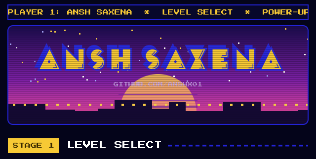</a> 
<a href="https://github.com/AnshX01/fpl-oracle">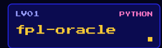</a><a href="https://github.com/AnshX01/Voxpilot">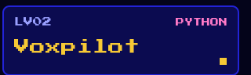</a> 
<a href="https://github.com/AnshX01/the-council">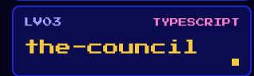</a><a href="https://github.com/AnshX01/Atlas">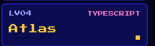</a> 
<a href="https://github.com/AnshX01/Orvo">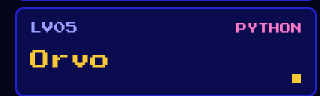</a><a href="https://github.com/AnshX01/Bantr">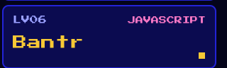</a> 
<a href="https://github.com/AnshX01/EasyPantry">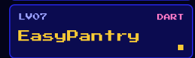</a><a href="https://github.com/AnshX01/DeepfakeDetection">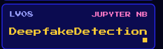</a> 
<a href="#arcade">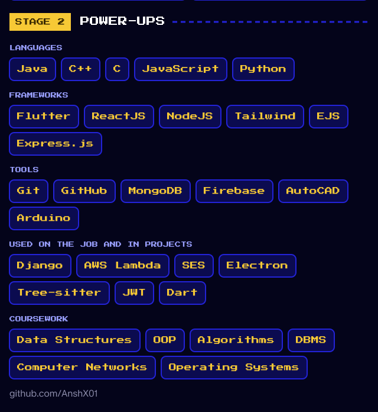</a> 
<a href="#arcade">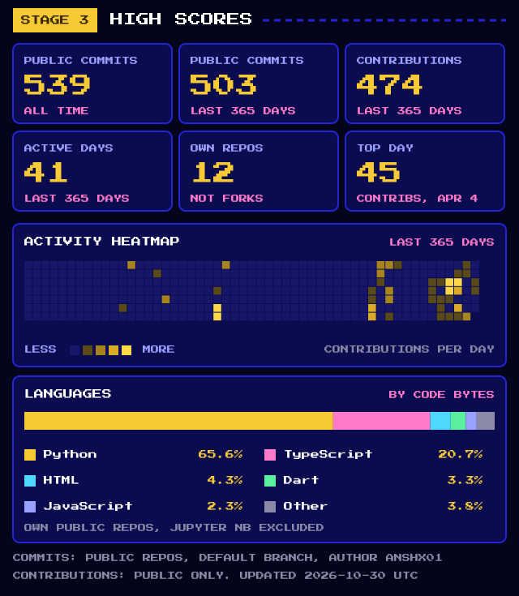</a>

